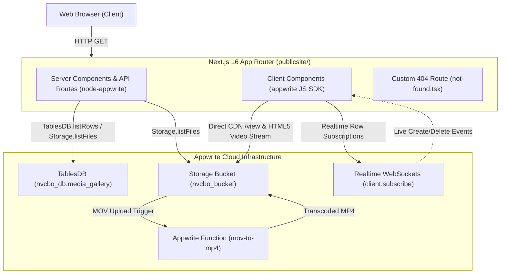

# Northern Vision CBO (NVCBO) — Web Platform

Official repository for **Northern Vision Community-Based Organization (NVCBO)**, a grassroots-led initiative working with indigenous and pastoralist communities in Northern Kenya to strengthen climate resilience, gender justice, education, and community wellbeing.

---

## Repository Structure

```text
nvcbo-landing-page/
├── publicsite/          # Active Next.js 16 + Appwrite Cloud web application
├── old-site/            # Archived legacy static HTML site & previous docs
├── assets/              # Legacy static site assets (retained for reference)
└── .github/workflows/   # Repository CI/CD workflows
```

---

## `publicsite/` Architecture Overview

[publicsite/](publicsite/) is a **Next.js 16 (App Router)** application built with **React 19**, **TypeScript 5**, **Tailwind CSS v4**, and backed by **Appwrite Cloud** (`TablesDB`, `Storage`, Realtime WebSockets, and Cloud Functions). It is configured with `output: "standalone"` in [publicsite/next.config.ts](publicsite/next.config.ts) for Node/SSR deployment (Appwrite Sites SSR).



---

## Application Routes (`publicsite/src/app/`)

| Route | Rendering / Source | Purpose |
| :--- | :--- | :--- |
| `/` | Static | Homepage — animated gradient hero, 4-column program cards, methodology glass cards |
| `/about` | Static | Our Story, Beliefs, How We Work, Partners, 2025 Review |
| `/healing-circles` | Static | Healing Circles overview & pillars |
| `/healing-circles/circle-keepers` | Static + Modal Gallery | Circle Keeper training & `CircleGalleryModal` |
| `/healing-circles/community-dialogues` | Static + Modal Gallery | Community Dialogues & fullscreen lightbox |
| `/healing-circles/indigenous-knowledge` | Static | Indigenous knowledge preservation frameworks |
| `/our-impact` | Dynamic (SSR) | Impact tracks overview |
| `/our-impact/climate-resilience` | Dynamic (SSR) | Dryland farming & climate adaptation metrics |
| `/our-impact/eco-tourism` | Dynamic (SSR) | Eco-Tourism Hub & `VisitApplicationForm` |
| `/our-impact/education-youth` | Static / Track Page | Education & youth empowerment programs |
| `/our-impact/gender-equality` | Static / Track Page | Gender justice & inclusion initiatives |
| `/our-impact/gotu-farm` | Dynamic + Gallery | Gotu Gamachu Farm & `FarmGallery` |
| `/our-impact/holiday-camp` | Interactive Form | Digital Literacy Camp & `RegistrationForm` |
| `/our-impact/indigenous-knowledge` | Static / Track Page | Indigenous knowledge impact track |
| `/our-impact/peace-security` | Static / Track Page | Peacebuilding & community security |
| `/resources` | Dynamic (SSR) | Learning hub & `ResourcesGallery` (Appwrite Storage) |
| `/resources/publications/two-worldviews` | Interactive | *Two Worldviews* publication (`PublicationInteractive`) |
| `/media-gallery` | Dynamic (SSR + Realtime WS) | `MediaGalleryClient` — `TablesDB.listRows` + live WebSocket updates + native MP4 player |
| `/shop` | Feature-flagged (`NEXT_PUBLIC_ENABLE_SHOP`) | NVCBO merchandise catalog (falls back to `notFound()` when disabled) |
| `/api/gallery-images` | Serverless Route Handler | Returns bucket image URLs via `getSpecificBucketImages` |
| `/_not-found` | Custom `not-found.tsx` | Dark-mode "Under Active Development" page with newsletter subscription form |

---

## Key Technical Decisions

- **Direct CDN `/view` Delivery**: Images and MP4 videos use Appwrite's `/storage/buckets/{bucketId}/files/{fileId}/view?project={projectId}` endpoint rather than image transformation endpoints, avoiding `HTTP 402` transformation quota limits. (`images.unoptimized: true` is also set in [publicsite/next.config.ts](publicsite/next.config.ts).)
- **Realtime Media Sync**: [publicsite/src/app/media-gallery/page.tsx](publicsite/src/app/media-gallery/page.tsx) uses `export const dynamic = 'force-dynamic'` with cursor-paginated `TablesDB.listRows` on the server, while `MediaGalleryClient` subscribes to `databases.nvcbo_db.tables.media_gallery.rows` via Appwrite Realtime WebSockets for live updates without a page reload.
- **Automated MOV-to-MP4 Transcoding**: [publicsite/appwrite-functions/mov-to-mp4/](publicsite/appwrite-functions/mov-to-mp4/) contains an Appwrite Cloud Function (`fluent-ffmpeg` + `@ffmpeg-installer/ffmpeg`) and bulk conversion scripts to convert `.mov` uploads into browser-playable `.mp4` streams.
- **Maintenance & Seeding Scripts**: Root-level TypeScript/JS scripts inside `publicsite/` (`seed-gallery.ts`, `seed-tables.ts`, `check-schema.ts`, `upload-*.ts`, `sync-*-bucket.ts`) support Appwrite schema checks, bucket syncing, and media seeding.

---

## Local Development (`publicsite/`)

1. Navigate to `publicsite/` and install dependencies:
   ```bash
   cd publicsite
   npm install
   ```
2. Configure `.env` (never commit secrets — see [publicsite/SECURITY.md](publicsite/SECURITY.md)):
   ```env
   NEXT_PUBLIC_APPWRITE_ENDPOINT=https://cloud.appwrite.io/v1
   NEXT_PUBLIC_APPWRITE_PROJECT_ID=your_project_id
   NEXT_PUBLIC_APPWRITE_DATABASE_ID=nvcbo_db
   NEXT_PUBLIC_APPWRITE_BUCKET_ID=nvcbo_bucket
   APPWRITE_API_KEY=your_secret_api_key
   ```
3. Start the development server:
   ```bash
   npm run dev
   ```
   Open [http://localhost:3000](http://localhost:3000).

---

## Further Documentation

- [publicsite/README.md](publicsite/README.md) — Platform overview, features, and Appwrite Sites SSR deployment
- [publicsite/docs/TECHNICAL_ARCHITECTURE.md](publicsite/docs/TECHNICAL_ARCHITECTURE.md) — Detailed architecture, schema, and Realtime sequence diagrams
- [publicsite/docs/NON_TECHNICAL_MANUAL.md](publicsite/docs/NON_TECHNICAL_MANUAL.md) — Visual sitemaps, user journeys, and wireframes
- [publicsite/SECURITY.md](publicsite/SECURITY.md) — Environment variable and secret handling guidelines
- [old-site/README.md](old-site/README.md) — Archived documentation for the legacy Bootstrap static site
