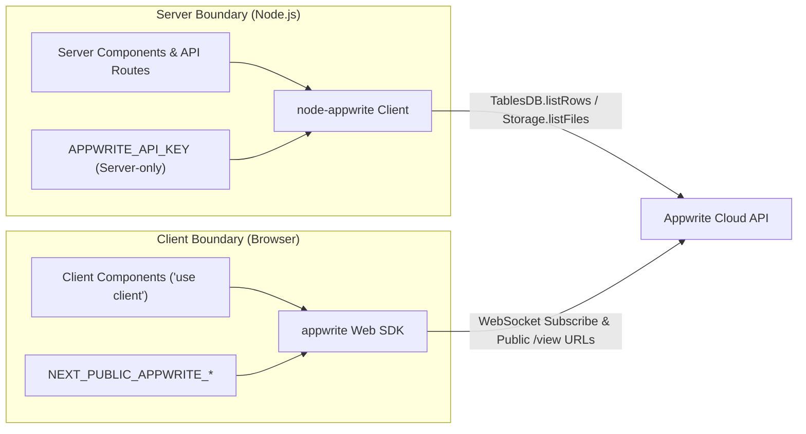

# 01 — System Architecture

[← Back to Wiki Index](README.md)

## Technology Stack

| Layer | Technology | Version / Notes |
| :--- | :--- | :--- |
| **Framework** | Next.js (App Router) | `16.2.10` ([package.json](../../package.json)) |
| **UI Library** | React / React DOM | `19.2.4` |
| **Language** | TypeScript | `^5` (`typescript.ignoreBuildErrors: true` in [next.config.ts](../../next.config.ts)) |
| **Styling** | Tailwind CSS v4 | `@tailwindcss/postcss` `^4` + custom CSS variables |
| **Icons** | Lucide React | `^1.24.0` |
| **Server BaaS SDK** | `node-appwrite` | `^27.0.0` (used in Server Components, API routes, Cloud Function, and CLI scripts) |
| **Client BaaS SDK** | `appwrite` | `^26.2.0` (used in Client Components for Realtime WebSocket subscriptions) |
| **E2E / Tooling** | Playwright & ESLint | `@playwright/test` `^1.61.1`, `eslint` `^9`, `eslint-config-next` `16.2.10` |

---

## Next.js Configuration & Build Output

In [next.config.ts](../../next.config.ts):
- **`output: "standalone"`**: Produces a self-contained Node.js server bundle suitable for SSR compute platforms (such as Appwrite Sites SSR) rather than a static HTML-only export.
- **`images.unoptimized: true`**: Disables Next.js built-in image optimization proxy so images are served directly from `public/` or Appwrite Storage CDN `/view` URLs.
- **`images.remotePatterns`**: Whitelists Appwrite Cloud endpoints and the `northernvisionke.org` (`www` and apex) domains over HTTPS.

---

## Server vs. Client Execution Boundaries

`publicsite` enforces a strict separation between **server-only** and **browser-safe** Appwrite access:

1. **Server Components & Route Handlers**:
   - Initialize `new Client()` from `node-appwrite` with `NEXT_PUBLIC_APPWRITE_ENDPOINT`, `NEXT_PUBLIC_APPWRITE_PROJECT_ID`, and `APPWRITE_API_KEY`.
   - Query `TablesDB` (`listRows`) or `Storage` (`listFiles`) and pass plain serialized props down to Client Components.
2. **Client Components (`"use client"`)**:
   - Never import `node-appwrite` or read `APPWRITE_API_KEY`.
   - Use `appwrite` Web SDK with only `NEXT_PUBLIC_APPWRITE_ENDPOINT` and `NEXT_PUBLIC_APPWRITE_PROJECT_ID` to open Realtime WebSocket subscriptions.
   - Render media directly from Appwrite Storage `/view` URLs.

---

## Rendering Strategies

- **Static / Prerendered Routes**: Content-focused pages (`/`, `/about`, `/healing-circles/*`) are statically rendered by Next.js.
- **Dynamic SSR (`export const dynamic = 'force-dynamic'`)**: Pages backed by live Appwrite data—such as `/media-gallery`—opt out of static caching so every request fetches the latest `TablesDB` rows.
- **Feature-Flagged SSR**: `/shop` reads `process.env.NEXT_PUBLIC_ENABLE_SHOP` at request time and invokes `notFound()` when disabled.
- **API Route Handlers**: `/api/gallery-images` exposes a JSON `GET` endpoint for fetching curated Storage `/view` URLs on demand.
