# 02 — Routing & Pages

[← Back to Wiki Index](README.md)

All routes live under `src/app/` using the Next.js App Router convention.

```mermaid
flowchart TD
    Root["/ (Homepage)"] --> About["/about"]
    Root --> Healing["/healing-circles"]
    Root --> Impact["/our-impact"]
    Root --> Resources["/resources"]
    Root --> Media["/media-gallery"]
    Root --> Shop["/shop (Feature-Flagged)"]

    Healing --> HK["/healing-circles/circle-keepers"]
    Healing --> HD["/healing-circles/community-dialogues"]
    Healing --> HI["/healing-circles/indigenous-knowledge"]

    Impact --> IC["/our-impact/climate-resilience"]
    Impact --> IE["/our-impact/eco-tourism"]
    Impact --> IEd["/our-impact/education-youth"]
    Impact --> IG["/our-impact/gender-equality"]
    Impact --> IF["/our-impact/gotu-farm"]
    Impact --> IH["/our-impact/holiday-camp"]
    Impact --> II["/our-impact/indigenous-knowledge"]
    Impact --> IP["/our-impact/peace-security"]

    Resources --> Pub["/resources/publications/two-worldviews"]
```

---

## Route Inventory

### Core & Utility Routes
- **`/`** ([src/app/page.tsx](../../src/app/page.tsx)): Landing page featuring the animated gradient hero title, 4-column program overview cards, and methodology glass cards.
- **`/about`** ([src/app/about/page.tsx](../../src/app/about/page.tsx)): Anchor-linked organizational overview covering Story, Beliefs, How We Work, Partners, and 2025 Review.
- **`/shop`** ([src/app/shop/page.tsx](../../src/app/shop/page.tsx)): Merchandise catalog (Copper Water Bottle, Hoodies/T-Shirts, Plain Paper Journal, Educational Coloring Books, Exercise Books). Gated by `process.env.NEXT_PUBLIC_ENABLE_SHOP === 'true'`; otherwise calls `notFound()` and sets `robots: 'noindex, nofollow'`.
- **`not-found.tsx`** ([src/app/not-found.tsx](../../src/app/not-found.tsx)): Custom dark-mode 404 / "Under Active Development" fallback with a client-side newsletter subscription form (also catches disabled `/shop` and unbuilt routes like `/contact` or `/become-a-partner`).

### Healing Circles (`/healing-circles`)
- **`/healing-circles`** ([page.tsx](../../src/app/healing-circles/page.tsx)): Program pillars, overview, and circle request CTA.
- **`/healing-circles/circle-keepers`** ([page.tsx](../../src/app/healing-circles/circle-keepers/page.tsx)): Circle Keeper training details + [CircleKeepersGallery.tsx](../../src/app/healing-circles/circle-keepers/CircleKeepersGallery.tsx).
- **`/healing-circles/community-dialogues`** ([page.tsx](../../src/app/healing-circles/community-dialogues/page.tsx)): Community dialogues narrative + `CircleGalleryModal` lightbox.
- **`/healing-circles/indigenous-knowledge`** ([page.tsx](../../src/app/healing-circles/indigenous-knowledge/page.tsx)): Indigenous knowledge preservation frameworks.

### Our Impact (`/our-impact`)
Server Components in `/our-impact` and its tracks follow a **resilient static-fallback + dynamic-merge pattern**: they define static `PROJECT_TRACKS` metadata and query `TablesDB.listRows(<DATABASE_ID>, 'projects')` via `node-appwrite`. If matching `slug` rows exist, dynamic `title` / `description` fields override the static defaults; if Appwrite is unreachable, the page gracefully falls back to static content.

- **`/our-impact`** ([page.tsx](../../src/app/our-impact/page.tsx)): Directory of all 8 impact tracks.
- **`/our-impact/climate-resilience`** ([page.tsx](../../src/app/our-impact/climate-resilience/page.tsx)): Dryland farming & climate adaptation metrics.
- **`/our-impact/eco-tourism`** ([page.tsx](../../src/app/our-impact/eco-tourism/page.tsx)): Eco-Tourism Hub + interactive [VisitApplicationForm.tsx](../../src/app/our-impact/eco-tourism/VisitApplicationForm.tsx) (client-side validated visitation request form).
- **`/our-impact/education-youth`** ([page.tsx](../../src/app/our-impact/education-youth/page.tsx)): Education & youth empowerment.
- **`/our-impact/gender-equality`** ([page.tsx](../../src/app/our-impact/gender-equality/page.tsx)): Gender justice & inclusion.
- **`/our-impact/gotu-farm`** ([page.tsx](../../src/app/our-impact/gotu-farm/page.tsx)): Gotu Gamachu Farm + [FarmGallery.tsx](../../src/app/our-impact/gotu-farm/FarmGallery.tsx) (renders Storage `/view` URLs built from `NEXT_PUBLIC_APPWRITE_ENDPOINT`, `NEXT_PUBLIC_APPWRITE_BUCKET_ID`, and `NEXT_PUBLIC_APPWRITE_PROJECT_ID`).
- **`/our-impact/holiday-camp`** ([page.tsx](../../src/app/our-impact/holiday-camp/page.tsx)): Digital Literacy Camp + [RegistrationForm.tsx](../../src/app/our-impact/holiday-camp/RegistrationForm.tsx) (parent email interest registration).
- **`/our-impact/indigenous-knowledge`** ([page.tsx](../../src/app/our-impact/indigenous-knowledge/page.tsx)): Indigenous knowledge impact track.
- **`/our-impact/peace-security`** ([page.tsx](../../src/app/our-impact/peace-security/page.tsx)): Peacebuilding & community security.

### Resources, Media & API
- **`/resources`** ([page.tsx](../../src/app/resources/page.tsx)): Learning hub featuring [ResourcesGallery.tsx](../../src/app/resources/ResourcesGallery.tsx) (two-row gallery with portal-based lightbox, pause-on-hover, keyboard & touch swipe navigation).
- **`/resources/publications/two-worldviews`** ([page.tsx](../../src/app/resources/publications/two-worldviews/page.tsx)): Interactive publication view powered by [PublicationInteractive.tsx](../../src/app/resources/publications/two-worldviews/PublicationInteractive.tsx).
- **`/media-gallery`** ([page.tsx](../../src/app/media-gallery/page.tsx)): Dynamic SSR + Realtime WebSocket media hub ([MediaGalleryClient.tsx](../../src/app/media-gallery/MediaGalleryClient.tsx)).
- **`/api/gallery-images`** ([route.ts](../../src/app/api/gallery-images/route.ts)): `GET` Route Handler returning JSON image URLs from `getSpecificBucketImages()`.
