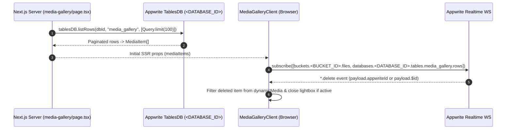

# 03 — Appwrite Data & Media Architecture

[← Back to Wiki Index](README.md)

## Appwrite `TablesDB` Integration

`publicsite` uses Appwrite's `TablesDB` API (via `node-appwrite`) for structured content.

### Tables Used
1. **`media_gallery`** (in database `<DATABASE_ID>` via `NEXT_PUBLIC_APPWRITE_DATABASE_ID`):
   - Consumed by [src/app/media-gallery/page.tsx](../../src/app/media-gallery/page.tsx) (`force-dynamic`).
   - Fetched using cursor pagination (`Query.limit(100)` + `Query.cursorAfter(lastId)`) so galleries exceeding 100 items load completely.
   - Row fields mapped to `MediaItem`:
     - `id` (`$id`), `title`, `category` (`GOTU` | `BIOLIT` | `BRUNS_KENYA` | `SWEDEN` | `WOLFRAM`), `type` (`image` | `video`), `appwriteId` (Storage file ID), `caption`, `colSpan`.
2. **`projects`** (in database `<DATABASE_ID>`):
   - Consumed by `/our-impact` and its track pages via `tablesDB.listRows(dbId, 'projects')`.
   - Matched against static track definitions by `slug` to allow dynamic `title` and `description` overrides without breaking page rendering if the database is unavailable.

---

## Direct CDN `/view` Delivery (Quota-Safe Media)

To avoid Appwrite Storage image transformation quota limits (`HTTP 402`), **all** images and MP4 video streams bypass `/preview` transformation endpoints and use the direct `/view` endpoint:

```text
<NEXT_PUBLIC_APPWRITE_ENDPOINT>/storage/buckets/<NEXT_PUBLIC_APPWRITE_BUCKET_ID>/files/<FILE_ID>/view?project=<NEXT_PUBLIC_APPWRITE_PROJECT_ID>
```

- **Images**: Rendered via standard `` tags (with `images.unoptimized: true` in `next.config.ts`) and an `onError` handler in `MediaGalleryClient` that removes broken/deleted items from local state.
- **Videos**: Rendered as muted `preload="metadata"` `<video>` cards in the grid, and streamed with native `<video controls autoPlay playsInline>` in the fullscreen lightbox.

---

## Realtime Media Gallery Synchronization

[MediaGalleryClient.tsx](../../src/app/media-gallery/MediaGalleryClient.tsx) initializes the browser `appwrite` `Client` (using only `NEXT_PUBLIC_APPWRITE_ENDPOINT` and `NEXT_PUBLIC_APPWRITE_PROJECT_ID`) and subscribes to two Realtime channels:
- `buckets.<BUCKET_ID>.files`
- `databases.<DATABASE_ID>.tables.media_gallery.rows`



Additionally, `MediaGalleryClient` reads `?category=` from `window.location.search` on mount so deep links (e.g., `/media-gallery?category=GOTU`) pre-select the matching filter pill.

---

## Server-Side Storage Helpers (`src/app/lib/`)

- **[listAppwriteImages.ts](../../src/app/lib/listAppwriteImages.ts)**: `listBucketImages()` paginates through all files in `<BUCKET_ID>` with `Query.limit(100)` + `Query.cursorAfter(cursor)`, filters `mimeType.startsWith("image/")`, and returns `{ src, alt, caption }` objects using `/view` URLs.
- **[getSpecificBucketImages.ts](../../src/app/lib/getSpecificBucketImages.ts)**: `getSpecificBucketImages()` maps a curated list of 6 file IDs in `<BUCKET_ID>` into `/view` URLs for the `/api/gallery-images` endpoint.
