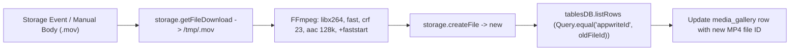

# 05 — Cloud Functions & Operational Scripts

[← Back to Wiki Index](README.md)

## Appwrite Cloud Function: `mov-to-mp4`

Located in [appwrite-functions/mov-to-mp4/](../../appwrite-functions/mov-to-mp4/), this Node.js Appwrite Function automatically transcodes `.mov` video uploads into web-compatible `.mp4` files.

### Dependencies ([package.json](../../appwrite-functions/mov-to-mp4/package.json))
- `node-appwrite` (`^27.0.0`)
- `fluent-ffmpeg` (`^2.1.3`)
- `@ffmpeg-installer/ffmpeg` (`^1.1.0`)
- `dotenv` (`^17.4.2`)

### Execution Flow ([src/main.js](../../appwrite-functions/mov-to-mp4/src/main.js))

1. **Trigger Parsing**: Accepts either `APPWRITE_FUNCTION_EVENT_DATA` (Storage upload event) or `req.body` (manual Appwrite Console execution). Skips non-`.mov` files.
2. **Download**: Downloads the source `.mov` from the triggering bucket into `/tmp/`.
3. **Transcode**: Runs FFmpeg with `libx264`, `-preset fast`, `-crf 23`, `aac` audio at `128k`, and `-movflags +faststart` for progressive browser playback.
4. **Upload & Sync**: Uploads the `.mp4` via `InputFile.fromPath` + `storage.createFile`, then queries `media_gallery` in `<DATABASE_ID>` to update the matching row's `appwriteId` to the new MP4 file ID.

### Companion Function Scripts
Inside `appwrite-functions/mov-to-mp4/`:
- `bulk-convert.js` / `cloud-bulk-convert.js` — batch conversion utilities
- `insert-videos-db.js` / `verify-db.js` — database row insertion and verification
- `test-local.js` — local function harness
- [DEPLOYMENT.md](../../appwrite-functions/mov-to-mp4/DEPLOYMENT.md) — deployment instructions for the function

---

## Root Operational & Seeding Scripts (`publicsite/`)

These CLI scripts are run manually with local `.env` credentials (containing `APPWRITE_API_KEY`) and are never bundled into the Next.js frontend:

| Script | Purpose |
| :--- | :--- |
| `seed-gallery.ts` / `seed-tables.ts` | Seed `media_gallery` and `projects` rows in Appwrite `TablesDB` |
| `check-schema.ts` / `check-sweden.ts` | Inspect `TablesDB` schema and verify category records |
| `upload-biolite.ts`, `upload-pdf-images.ts`, `upload-sweden.ts`, `upload-wolfram.ts` | Upload category media assets to Appwrite Storage |
| `sync-sweden-bucket.ts`, `sync-wolfram-bucket.ts` | Synchronize Storage bucket files with `TablesDB` rows |
| `test-url.ts` | Verify generated Appwrite `/view` URLs |
| `screenshot.js` | Playwright screenshot utility for visual verification |
| `jules-setup.sh` | Environment setup helper script |
