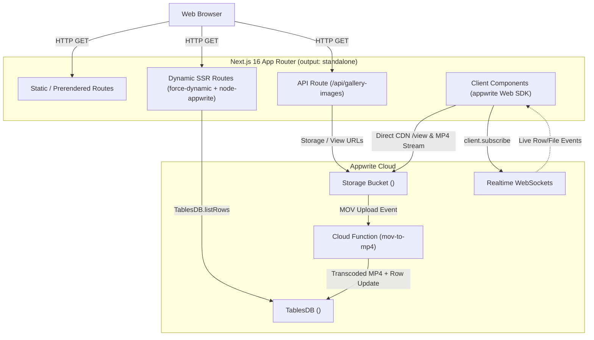

# Northern Vision CBO (`publicsite`) — Master Architecture Wiki

Welcome to the Master Architecture Wiki for [publicsite](../../), the **Next.js 16 (App Router) + Appwrite Cloud** web platform powering **Northern Vision Community-Based Organization (NVCBO)**.

> [!IMPORTANT]
> **Secret-Free Documentation Policy**: This wiki intentionally omits all live Appwrite identifiers, endpoints, file IDs, and API keys. All configuration is referenced strictly by environment variable names (e.g., `NEXT_PUBLIC_APPWRITE_PROJECT_ID`, `APPWRITE_API_KEY`) and generic placeholders (`<PROJECT_ID>`, `<DATABASE_ID>`, `<BUCKET_ID>`, `<FILE_ID>`).

---

## Wiki Index

| Page | Scope |
| :--- | :--- |
| [01 — System Architecture](01-system-architecture.md) | Next.js 16 App Router, `output: "standalone"`, Server vs. Client SDK boundaries, rendering modes |
| [02 — Routing & Pages](02-routing-and-pages.md) | Full route map, feature-flagged `/shop`, Healing Circles, Impact tracks, interactive forms, and `/api/gallery-images` |
| [03 — Appwrite Data & Media](03-appwrite-data-and-media.md) | `TablesDB` cursor pagination, Direct CDN `/view` delivery, Realtime WebSockets, and Storage helpers |
| [04 — Components & Styling](04-components-and-styling.md) | Root layout, Google Fonts, Tailwind CSS v4 `@theme` tokens, shared navigation, and lightbox modals |
| [05 — Cloud Functions & Scripts](05-cloud-functions-and-scripts.md) | `mov-to-mp4` FFmpeg Appwrite Function and root seeding/sync/verification scripts |
| [06 — Security & Deployment](06-security-and-deployment.md) | Environment variable matrix, secret hygiene, Appwrite Sites SSR deployment, and custom domain cookies |

---

## High-Level Stack & Topology

---

## Related Documentation

- [Technical Architecture Blueprint](../TECHNICAL_ARCHITECTURE.md)
- [Non-Technical Platform Manual](../NON_TECHNICAL_MANUAL.md)
- [Platform README](../../README.md)
- [Security Policy](../../SECURITY.md)
- [AI Agent Rules](../../AGENTS.md)
